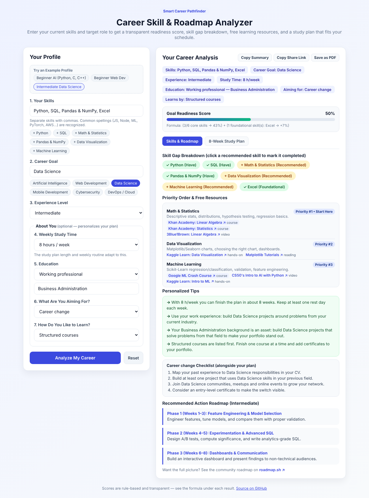

# CareerAI — Career Skill & Roadmap Analyzer

Enter your current skills, a career goal and your experience level, plus (optionally) your weekly study time, education, what you are aiming for and how you like to learn. The app shows how ready you are, which skills you are missing, free resources for each one, and a study plan that fits your schedule.

**Live demo:** https://sevim-123.github.io/CareerAI/



## Features

- **6 career tracks:** Artificial Intelligence, Web Development, Data Science, Mobile Development (Flutter), Cybersecurity, DevOps / Cloud
- **3 experience levels:** each level has its own roadmap and its own study plan
- **Personalized profile (optional):**
  - *Weekly study time* (3–15 h) stretches or compresses the plan (e.g. 20 weeks at 3 h/week, 6 weeks at 15 h/week) and scales the weekly routine
  - *Education and department* add stage-specific tips (e.g. internship timing for 3rd–4th year students)
  - *Goal type* (internship, first job, career change, freelance, academic) adds a matching action checklist
  - *Learning style* (video, reading, hands-on, courses) puts matching resources first
- **Transparent readiness score:** the formula is shown under every result
- **Skill gap breakdown:** click a recommended skill once you have learned it and the score updates
- **Free learning resources:** links to official docs, free courses and videos for every missing skill, labelled by type
- **Study plan progress tracking:** tick each period when you finish it
- **Share link:** the whole analysis, including your progress, is stored in the URL
- **Save as PDF:** a print-friendly layout that includes all resource links
- **Smart input:** recognizes common spellings (`JS`, `Node`, `ML`, `PyTorch`, `AWS`…) and Turkish goal names (`Yapay Zekâ`, `Siber Güvenlik`, `Veri Bilimi`…)
- Works offline, has no build step or dependencies, and is keyboard and screen-reader friendly

## How the score works

```
score = (core skills you have or completed / 6) × 85  +  min(15, foundational skills × 7)
```

Each track has 6 **core skills** and a few **foundational skills**. For example, C/C++ count as foundational for AI, and Excel and R count as foundational for Data Science.

## Project structure

```
index.html      page markup
style.css       styles (including print / PDF layout)
careers.js      all career data: tracks, roadmaps, study plans, aliases, resources, profile options
app.js          app logic
assets/         favicon, social preview image, screenshot
```

## Adding a new career track

1. Open `careers.js` and copy one of the objects inside `tracks`.
2. Give it a new key and fill in `label`, `aliases`, 6 `skills`, `skillNotes`, a `roadmap` (3 phases per level) and a `studyPlan` (6 rows per level).
3. Add every new skill to `skillAliases` (in lowercase) and add links for it to `resources`.

Nothing else needs to change. The new track appears in the goal buttons automatically.

## Roadmap

- [ ] AI-generated plans for any career goal, using a serverless API proxy
- [ ] Extract skills automatically from a pasted CV
- [ ] Turkish interface
